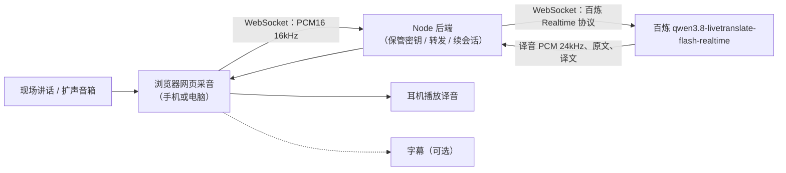

# AGENTS.md · 网页同传助手（live_translate）

> 给在这个仓库里干活的 AI agent / 开发者看的总说明：做什么、怎么做、做到哪一步、哪些规矩不能破。
> 每完成一个里程碑，更新文末「进度」一节。

## 0. 一句话

用浏览器打开 **https://magictoolse.com**，网页采集现场声音 → 后端转发给阿里云百炼实时同传模型 → 耳机里听中文译音，字幕可选。手机、电脑都能用。默认场景：**英语演讲 → 中文收听**。



---

## 1. 已知的基础设施（2026-10-26 核对过）

| 项 | 值 | 状态 |
|---|---|---|
| 服务器 | `112.124.61.7`（阿里云，杭州），用户 `root` | 在线，nginx 1.28 默认页 |
| 域名 | `magictoolse.com` | A 记录已指向上面的 IP；HTTPS 已可访问（证书已配） |
| 代码仓库 | `https://github.com/alovwang-sys/live_translate.git`，分支 `main` | 空仓库，待首次推送 |
| 百炼业务空间 | `llm-xwv932pj8rnj30mx`（北京） | API Key 可用，已列出模型 |
| 同传模型 | `qwen3.8-livetranslate-flash-realtime`（首选）；备选 `qwen3.5-livetranslate-flash-realtime` | 已在空间里确认存在 |

**密钥规矩（硬性）：**
- API Key、服务器密码只放在 `.env`（本机）和服务器上的 `/opt/live_translate/.env`，**永远不进 git、不进前端代码、不写进本文件**。
- 服务器登录改用 SSH 公钥（`ssh-copy-id root@112.124.61.7`），之后关闭密码登录。
- 这两样凭据曾在聊天里明文出现过，**上线前请在阿里云控制台各轮换一次**。

---

## 2. 百炼实时同传接口要点

来源：[接入指南](https://help.aliyun.com/zh/model-studio/qwen3-5-livetranslate-flash-realtime)。参数以官方文档为准，变动时以文档覆盖本节。

- **地址**：`wss://llm-xwv932pj8rnj30mx.cn-beijing.maas.aliyuncs.com/api-ws/v1/realtime?model=qwen3.8-livetranslate-flash-realtime`
- **鉴权**：请求头 `Authorization: Bearer $DASHSCOPE_API_KEY`（只能在后端加，浏览器 WebSocket 加不了头，这也是必须要后端的原因之一）
- **音频格式**：输入 PCM16 单声道 **16 kHz**；输出 PCM16 **24 kHz**
- **会话配置** `session.update`（qwen3.8）：
  - `session.translation.language`: `"zh"`（目标语种）
  - `session.output_modalities`: `["text","audio"]`（语音模式）或 `["text"]`（仅字幕，更便宜）
  - `session.voice`: 默认 `Tina`
  - `session.audio.input.turn_detection.type`: 默认 `speaker_detection`
  - `session.translation.corpus.phrases`: 术语/人名映射表（≤1000 条），用于提高专有名词准确度
- **客户端 → 服务端**：`input_audio_buffer.append`（Base64 音频）；结束时 `session.finish`
- **服务端 → 客户端**（需要处理的）：
  - `session.created` / `session.updated` / `session.finished`
  - `input_audio_buffer.speech_started` / `speech_stopped`
  - 原文：`conversation.item.input_audio_transcription.delta` / `.completed`
  - 译文：`response.audio_transcript.delta` / `.done`（文本+音频模式）；`response.text.delta` / `.done`（仅文本模式）
  - 译音：`response.audio.delta`（Base64 PCM）/ `response.audio.done`
  - `response.done`、`error`
- **计费**：音频输入 7 token/秒，输出 12.5 token/秒，单价看[计费页](https://help.aliyun.com/zh/model-studio/qwen3-8-livetranslate-flash-realtime)。原方案估算约 8.21 元/小时（语音模式），开发时按最新单价复核。
- **单会话时长上限**：文档未写明。M1 阶段实测；后端按「到上限前主动续会话」设计。

---

## 3. 技术选型

| 部分 | 选择 | 理由 |
|---|---|---|
| 后端 | Node.js 22 + TypeScript，`fastify` + `ws` | 一个进程同时提供静态页和 WebSocket 中转；逻辑主要是转发 |
| 前端 | 原生 TypeScript + Vite，不用框架 | 页面就一屏；核心难点在音频而不是 UI |
| 采音 | `getUserMedia` + `AudioWorklet`，在 worklet 里降采样到 16 kHz PCM16，每 100 ms 一包 | 手机/电脑通用，延迟低 |
| 播放 | `AudioWorklet` 环形缓冲播放 24 kHz PCM | 可精确控制积压、变速、丢旧句 |
| 部署 | 服务器上 `systemd` 跑 Node（`127.0.0.1:8787`），nginx 反代 `/` 与 `/ws`（带 WebSocket Upgrade） | 现有 nginx + 证书直接复用 |
| 不需要 | GPU、数据库、自建模型、Docker（首版） | |

### 目录结构（计划）

```
live_translate/
├── AGENTS.md
├── .env.example          # 字段说明，不含真实值
├── package.json
├── server/
│   ├── index.ts          # fastify：静态文件 + /ws
│   ├── relay.ts          # 浏览器 WS ⇄ 百炼 WS 中转、事件精简
│   ├── session.ts        # 会话生命周期：续会话、重连、尾句收尾
│   └── config.ts         # 读取 .env
├── web/
│   ├── index.html
│   ├── main.ts           # 状态机：自检 → 选模式 → 同传 → 停止
│   ├── capture.worklet.ts
│   ├── player.worklet.ts
│   ├── selftest.ts       # 收音自检
│   └── ui.ts             # 三个状态灯、字幕、错误提示
├── deploy/
│   ├── nginx.conf        # magictoolse.com 站点配置片段
│   ├── live_translate.service
│   └── deploy.sh         # 本机一键：build → rsync → 重启
└── docs/
    └── test-log.md       # 验收实测记录
```

### 浏览器 ⇄ 后端 协议（自定义，保持简单）

- 浏览器 → 后端：
  - 文本帧 `{"type":"start","mode":"audio"|"audio+text"|"text","target":"zh","phrases":{...}}`
  - 二进制帧：PCM16 16 kHz 原始数据（不做 Base64，省 33% 流量；后端再转 Base64）
  - 文本帧 `{"type":"stop"}`
- 后端 → 浏览器：
  - 文本帧 `{"type":"source","text","final"}` / `{"type":"target","text","final"}` / `{"type":"state",...}` / `{"type":"error",...}`
  - 二进制帧：译音 PCM16 24 kHz

---

## 4. 用户流程

1. 戴耳机，打开 magictoolse.com，点「开始」，允许麦克风。
2. **收音自检（约 30 秒）**：
   - 显示当前麦克风名（`MediaDeviceInfo.label`）；检测到蓝牙耳机麦克风时提醒。
   - 实时电平表，判断远处讲话音量够不够。
   - 「浏览器降噪开」和「关」（`echoCancellation/noiseSuppression/autoGainControl`）各录 8 秒回放对比，用户选好的那个；记到 `localStorage`。
   - 自检录音只在本地回放，不上传。
3. 选模式：语音 / 语音＋字幕 / 仅字幕 → 开始同传。
4. 听讲时：申请 `navigator.wakeLock` 保持常亮；页面显示 **采音 / 连接 / 播放** 三个状态灯；断线有明确提示并自动恢复。
5. 点「停止」：发 `session.finish`，等 `session.finished` 和译音播完再关闭，不丢尾句。

诊断：页面可展开「调试面板」，对照 电平 → 原文 → 译文 → 译音积压，分清是收音问题还是翻译问题。后端默认不保存任何录音。

---

## 5. 关键难点与做法

| 问题 | 做法 |
|---|---|
| 蓝牙耳机抢麦克风 | 自检显示实际设备；提供设备下拉框切换；收音差时建议有线耳机或手机外放麦克风 |
| 浏览器降噪压掉远处人声 | 自检 A/B 对比，记住选择；默认关 `noiseSuppression` 试一次 |
| 译音积压、越来越慢 | 播放器积压 > 3 s 时 1.15× 播放；> 6 s 时丢弃最旧的整句，只播最新；字幕完整保留 |
| 单会话时长上限 | 后端在上限前（或收到相关 error 时）新开一个百炼会话，在讲话间隙（`speech_stopped` 之后）切换，旧会话 `session.finish` 收尾 |
| 网络波动 / 断线 | 浏览器端指数退避重连（0.5 s→8 s），重连期间本地缓存最多 10 s 音频后补传；后端到百炼断线同样重连 |
| 手机锁屏 | 首版不支持后台运行；用 Wake Lock 防息屏，页面切后台时提示 |
| iOS Safari | AudioContext 必须在用户点击里 `resume()`；采样率可能是 48 kHz，降采样在 worklet 里做 |

---

## 6. 里程碑

每个里程碑做完都要：本机跑通 → 提交 → 更新「进度」。

- **M0 骨架**：仓库初始化、`.env`、package.json、fastify 起静态页 + `/ws`、push 到 GitHub。
- **M1 打通链路（命令行）**：`scripts/probe.ts` 读一个英文 wav，推给百炼，打印原文/译文、保存译音 wav；测出首包延迟、确认会话时长上限和 error 码。
- **M2 网页同传（本机 localhost）**：采音 worklet、后端中转、播放 worklet、字幕、三个模式、停止收尾。
- **M3 收音自检 + 稳定性**：自检页、设备切换、积压控制、续会话、断线重连、调试面板。
- **M4 上线 magictoolse.com**：systemd + nginx 反代 + `deploy.sh`；手机实测。
- **M5 验收**：按第 7 节跑三项测试，结果写入 `docs/test-log.md`。

### 本机开发

```bash
cp .env.example .env      # 填 DASHSCOPE_API_KEY
npm install
npm run dev               # http://localhost:8787 ，localhost 下麦克风无需 HTTPS
```

### 部署（M4 起）

```bash
./deploy/deploy.sh        # build → rsync 到 /opt/live_translate → systemctl restart live_translate
```

nginx 需要给 `/ws` 加 `proxy_http_version 1.1; proxy_set_header Upgrade $http_upgrade; proxy_set_header Connection "upgrade"; proxy_read_timeout 3600s;`。

---

## 7. 验收标准

| 测试 | 内容 | 通过标准 |
|---|---|---|
| 收音自检 | 现场录音或真实场地 | 识别出的原文基本完整 |
| 短时同传 | 5–10 分钟 | 讲话到听到译音 ≤ 4 秒；漏句很少 |
| 持续运行 | 30–60 分钟 | 延迟不随时间增长；中断 ≤ 1 次且 10 秒内自动恢复 |

交付：源码、启动/部署说明、手机访问方法、`docs/test-log.md` 实测记录（延迟、漏句、中断）。

## 8. 首版不做

火山引擎切换、PPT 图像识别、锁屏后台运行、多人共享收听、用户账号体系。

> 注意：网站公开后任何人都能用、费用记在这个账号上。M4 上线时至少加一个简单的访问口令（`ACCESS_TOKEN`，写在 `.env`），并在后端限制单连接时长和并发数。

---

## 9. 代码约定

- TypeScript strict；前后端共用 `shared/protocol.ts` 定义消息类型。
- 不打印 API Key；日志只记事件类型、时延、字节数，不记音频和全文（调试开关除外）。
- 提交信息用中文或英文都行，一次提交做一件事。

## 10. 待确认

1. 翻译方向固定「英 → 中」？是否需要页面上可切换源/目标语种？
2. 网站是否需要访问口令（建议要）？
3. 有没有 5–10 分钟现场录音、术语/讲者名单可以提供？

## 进度

- [x] 2026-10-26 方案定稿；核对模型名、接口参数；确认域名解析和 HTTPS
- [ ] M0 骨架
- [ ] M1 打通链路
- [ ] M2 网页同传
- [ ] M3 自检与稳定性
- [ ] M4 上线
- [ ] M5 验收
